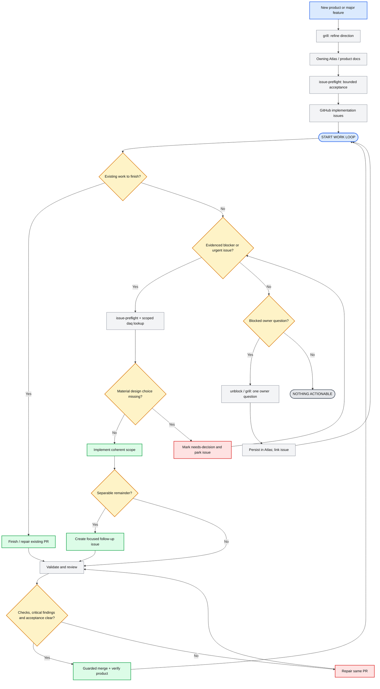

# dotfiles

Personal development-environment and reusable coding preferences.

## What belongs here

This repository stores portable defaults that are useful across projects. Repository-local configuration and pinned conventions remain authoritative when a project needs different behavior.

Keep secrets, credentials, machine-specific paths, and Git identity out of the repository.

## Safe one-command bootstrap (Linux and WSL)

From this repository, preview the complete setup before installing anything:

```sh
node scripts/bootstrap.mjs --dry-run
node scripts/bootstrap.mjs --apply
```

The bootstrap plans all existing Git, EditorConfig, Claude Code and Codex skills, and
`workctl` links before changing the filesystem. It refuses any conflicting file or
symlink **before creating links**, leaves correctly installed links alone, and is
idempotent. It never installs packages, fetches dependencies, publishes, or auto-installs
VS Code extensions. Preview never changes files.

It also sets up the tracked **personal VS Code preferences**:

- Native Linux: `~/.config/Code/User/settings.json` (or `$XDG_CONFIG_HOME/Code/User/settings.json`).
- WSL: `~/.vscode-server/data/Machine/settings.json` in Linux, **never** Windows-host
  settings. Native Windows support is intentionally deferred.

When no settings file exists, apply creates one. If it exists, the plan displays **only
missing preferences** and interactive apply asks for explicit `y` approval before adding
them; existing values and JSONC comments are preserved. Declining, running without a
terminal, or encountering unsafe/unparseable settings **skips the VS Code settings step**
without interfering with safe links. No user-owned settings file is silently overwritten.

Node.js 22.18+ (22.x) or 24.2+ (newer major versions) is required for the linked
`workctl` CLI. The bootstrap itself runs on the available Node.js runtime used for
repository validation.

## Home-level defaults

- `.gitconfig` — fast-forward-only pulls, pruned fetches, automatic upstream setup, rerere, zdiff3 conflicts, histogram diffs, autostash for explicit rebases, and review-friendly commit/status defaults.
- `.config/git/ignore` — only OS/editor trash. Semantic project ignores such as `.env` remain owned by each repository.
- `.editorconfig` — LF line endings, final newlines, two-space defaults, 100-column guidance, and Rust/Makefile overrides.

To run the older **home-links-only** command instead, preview with:

```sh
node scripts/link-home.mjs --dry-run
```

Apply them with:

```sh
node scripts/link-home.mjs
```

The linker is intentionally non-destructive: it refuses to replace an existing file or unrelated symlink.

## Project coding preferences

- `.oxfmtrc.json` — Oxfmt formatting defaults with deterministic import sorting.
- `.oxlintrc.json` — Oxlint correctness, suspicious-code, performance, TypeScript, control-flow, and import rules.
- `eslint.config.mjs` — dependency-free ESLint flat-config baseline for JavaScript projects that still need ESLint-specific integrations.

Copy or symlink these into a project when appropriate, then keep project-specific additions in that project. Do not make a project depend on this repository at runtime.

## Coding-agent workflow

**Design first for new products and major features:** `/steer` (guided interview or free-form idea discussion, using `grill` for consequential forks) → owning Decision Atlas / existing product docs → optional `/tech-steer` for consequential engineering trade-offs → `issue-preflight` → implementation issues → `work-loop`. Already-specified work, routine bugs and refactors can enter the loop directly. No second scheduler or queue is needed.

Implementation work runs through one global loop over GitHub issues. Product decisions use one
human-facing entry point backed by the existing specialist skills, without another loop:

- `skills/steer` — run `/steer` in the current repository either as a **guided interview** (one consequential A/B/C question at a time) or as a **free-form discussion** (describe multiple ideas; the agent groups them by feature, reconciles them with existing Atlas entries, asks about material conflicts, and records clear owner intent). Both modes **automatically reconcile approved, durably recorded Decisions into necessary bounded GitHub issues** through `issue-preflight`, reusing `grill`, `atlas-audit`, `unblock`, and `acceptance-contract`. Tentative ideas remain Questions, not automatic implementation work. Owner-approved, non-executable intent documentation is committed directly when permitted (or its existing documentation-only PR is merged promptly), without waiting on CI; implementation PRs remain separate. Issues derived from still-unmerged intent PRs remain non-actionable until that source lands.

- `skills/tech-steer` — evaluate material engineering alternatives against settled Atlas Decisions and actual integrations, defaulting to reuse-first options. Record approved or delegated, lasting technical choices in existing architecture docs or `docs/technical-decisions.md`; routine implementation details require no new document. It does not create a second issue loop or independently authorize issue writes.
- `skills/work-loop` — finish existing PRs, select evidenced blockers, implement and
  validate under each repository's instructions. Its `workctl.mjs` helper guards
  implementation PR merges using CI, mergeability, and unanswered P0/P1 Codex findings.
  Non-executable, owner-approved documentation is exempt from the CI/PR requirement.
  Targeted Codex reviews are advisory, not mandatory per-commit merge gates. Cross-repository
  dependencies become issues in the owning repository.
- `skills/unblock` — resolve blocking Questions discovered during execution; record owner answers in the Atlas when present, then link and unblock the issue.
- `skills/grill` — refine new product/major-feature direction **before** implementation issues; ask one consequential question at a time, then record concise Decisions/Questions in the owning Atlas when present (otherwise existing docs). Proactively use concrete illustrated A/B/C alternatives for unresolved visual choices.
- `skills/atlas-audit` — audit important historical decisions and implementation drift, propose reviewable Atlas updates, and propose bounded issues for owner-approved changes; apply issue writes only when explicitly requested or within an authorized work loop.
- `skills/issue-preflight` — translate approved direction into bounded, independently verifiable issues; if a major design choice is unresolved, route back to `grill` before implementation. Require owner-verifiable end-to-end product slices, not backend-only feature claims.
- `skills/acceptance-contract` — for changes to behavior or architecture, hand off specification-based acceptance tests to an independent agent before implementation, protect behavioral assertions, and fail closed to full test execution when impact mapping is uncertain.

**Default documentation model:** `AGENTS.md` defines repo-specific engineering boundaries;
a feature-oriented Decision Atlas defines owner-approved product behavior and outstanding
Questions; an ADR or `docs/technical-decisions.md` is **optional** for a non-obvious lasting architectural trade-off, chosen through `tech-steer` when useful.
Implementation belongs in code and tests, and GitHub issues contain the work to do.
Do not require an ADR, design plan, or separate Markdown specification for routine changes.

**Approved instruction fast path:** Owner-approved changes only to non-executable
instructions, plans and Decisions go directly into the owning default branch when
repository protection permits. Do not create a PR or require green CI simply to
persist direction, including direction to repair broken CI. Check the actual diff,
current head, repository rules, document integrity and any required human review;
land existing documentation-only PRs instead of leaving stale intent. The ordinary
PR and verification gates still apply to code, configuration, tests and
machine-enforced contracts, even if stored in Markdown.

**Flowcharts:** [human steering, skill routing, implementation and authority](docs/human-steering-flowcharts.md).

GitHub issues and pull requests are the only **execution state**. Product intent lives in the owning repository's Decision Atlas when present; roadmaps, ADRs and tests provide supporting detail without duplicating decision authority. Repositories keep their own instructions, conventions, tests and architecture; they do not define their own agent loops, claims, queues or status labels.

**Feature delivery rule:** Each user-facing feature issue must end in a real, independently verifiable user journey on GitHub Pages (or an equivalent product surface) with browser acceptance evidence and a check of the published result. Backend-only prerequisites remain technical issues, not completed product features. See `skills/issue-preflight` for exceptions and deployment timing.

### Work-loop mental model

The skill file is the operational definition; this diagram is the human-readable control flow. A current issue should produce one coherent PR. If the selected issue contains separable remainder beyond one coherent PR, create focused follow-up issues for that remainder rather than expanding the PR indefinitely. Unrelated findings are not added to the work queue.



For a guided session, use `/steer combat` to inspect current intent and answer one
consequential **define / decide / approve / revise / verify** question at a time. For a
free-form session, use `/steer discuss combat` or simply start describing ideas: the agent
collects them, sorts them by product feature, compares prior Decisions/Questions and
issues, records unambiguous owner intent, and asks one question at a time only to resolve
material gaps or contradictions. Both modes update existing relevant issues or create
only necessary bounded ones after approved intent is recorded, without extra permission;
implementation runs separately through `/work-loop`. You can invoke specialist skills
directly when needed.

To define a new product or major feature, invoke `grill` first (for example, "/grill ARPG combat architecture"). It asks one consequential question at a time, normally 3–5 per session, with concrete illustrated A/B/C alternatives for visual choices, and persists the answers in the repository-owned Atlas when present. Use scoped `daq` queries to reuse settled decisions; when the tool is unavailable, read the relevant Markdown. Only then use `issue-preflight` to turn that direction into bounded implementation issues. During work, `unblock` is the fallback for genuinely new blocking Questions. Neither skill requires a new global database, label, or queue. The work loop also invokes `acceptance-contract` for behavior and architecture changes. Independent acceptance authorship is a procedural handoff, not something a commit author or code review alone can prove.

**Using these skills in ChatGPT:** With GitHub connected, ask for the [steer skill](https://github.com/moritzbrantner/dotfiles/blob/main/skills/steer/SKILL.md) in interview mode, or say "Use /steer for Scrabble; I'll talk freely and you organize the ideas into the Decision Atlas, clarify contradictions and reconcile issues." For a design-only interview you can also invoke the [grill skill](https://github.com/moritzbrantner/dotfiles/blob/main/skills/grill/SKILL.md). For technical choices, ask for [tech-steer](https://github.com/moritzbrantner/dotfiles/blob/main/skills/tech-steer/SKILL.md) on a named repository or Atlas Decision; it records durable architectural rationale without implementing the choice. ChatGPT can read the current GitHub files and follow them. This repository link does not register a native ChatGPT slash command; refer to the skill explicitly when you want that workflow. For voice-only use, the short spoken option descriptions must stand on their own without images.

For a manual installation **instead of the bootstrap**, link Claude Code and Codex skills:

```bash
mkdir -p ~/.claude/skills ~/.agents/skills ~/.local/share/coding-agent
for s in skills/*/; do
  ln -sfn "$PWD/$s" ~/.claude/skills/"$(basename "$s")"
  ln -sfn "$PWD/$s" ~/.agents/skills/"$(basename "$s")"
done
ln -sfn "$PWD/skills/work-loop/workctl.mjs" ~/.local/share/coding-agent/workctl.mjs
```

Run the linked helper with `node ~/.local/share/coding-agent/workctl.mjs scan` for the global PR backlog or `node ~/.local/share/coding-agent/workctl.mjs pr dotfiles#15` for one PR.
The helper requires Node.js 22.18+ on the 22.x line or Node.js 24.2+ on newer lines for native
ESM entry-point detection (`import.meta.main`). Symlink invocation needs no launcher. Importing
the module keeps the exported helpers available without running the CLI.

## VS Code

- `.vscode/settings.json` — save-time Oxfmt then Oxlint fixes, focused navigation/refactoring aids, explicit Git synchronization behavior, compact editor presentation, and Rust/TOML formatting.
- `.vscode/extensions.json` — Oxc, ESLint, EditorConfig, Rust Analyzer, TOML, WSL, and Dev Container recommendations.

The VS Code files remain reusable workspace defaults. The bootstrap merges missing tracked preferences into the applicable personal Linux or WSL settings path, with consent for existing files; it does not change Windows-hosted settings or automatically install recommended extensions.

## Automatic disk maintenance (Linux)

Install the personal maintenance service once for a workspace collection:

```sh
python3 scripts/disk-maintenance.py install --workspace "$HOME/moritzbrantner" --apply
```

The command defaults to a preview without `--apply`. It installs links to this repository
and enables a daily persistent user timer. Configuration stays in
`~/.config/coding-agent/disk-maintenance.json`; repeated installation preserves configured
thresholds and adds only missing roots. The service intentionally uses that fixed configuration
path regardless of `XDG_CONFIG_HOME`. `XDG_CACHE_HOME` is honored for temporary verification
and package caches. Python 3.11+, Git and Linux `/proc` are required; systemd user services
are required for scheduling. Installation is explicit, separate from the general bootstrap.

The defaults remove Cargo-generated `target`, `.cargo-target`, and legacy `*-target`
directories after seven inactive days, or after 24 quiet hours when a target exceeds 10 GiB.
Below 50 GiB free, quiet outputs are cleaned oldest first until 75 GiB is available.
Only declared roots beneath the home directory are scanned. Cargo markers are required;
source, Git state, tracked files, symlink boundaries and outputs used by live processes are
preserved. Recent builds are kept. No cleanup runs through models, personal downloads,
virtual environments, `node_modules`, Bun/T3 installations or application databases.

The service runs supported `uv cache prune` and clears pip/npm caches when they exceed 1 GiB.
It pins each command to the inspected cache path and skips active package managers.
It never edits uv cache entries directly. An unreadable unknown same-user process prevents
deletion and reports unavailable safety evidence. Known root-owned service/credential
agents and sandboxed browser subprocesses are handled explicitly while retaining their
visible command-line checks; arbitrary uninspectable build processes are not exempt.

For a one-shot verification, use:

```sh
python3 ~/.local/share/coding-agent/disk-maintenance.py run -- cargo test --workspace
```

The wrapper uses a private target with incremental compilation disabled, returns the
command's exit status, and removes its output on success, failure, SIGINT and SIGTERM.
It refuses to start below the free-space reserve and stops its command group if that
reserve is crossed during execution. Keep reports outside its disposable target.
Abandoned wrapper directories are recovered by retention maintenance; live or detached
processes still using them are preserved. Commands that explicitly override Cargo's target
directory need their own cleanup lifecycle. Ordinary development builds can reuse their
existing targets and are covered by periodic retention rather than the wrapper's reserve.

Inspect the schedule and logs with `systemctl --user list-timers coding-agent-disk-maintenance.timer`
and `journalctl --user -u coding-agent-disk-maintenance.service`. Preview cleanup with
`python3 ~/.local/share/coding-agent/disk-maintenance.py maintain`; add `--apply` for an
immediate run. Disable scheduling with `systemctl --user disable --now coding-agent-disk-maintenance.timer`.
These controls bound regenerable development output; they do not impose a quota on retained
models, personal data or build commands that bypass the verification wrapper.

## Validation

Run:

```sh
node scripts/check.mjs
```

Configuration validation uses the tools that own the formats: Git validates `.gitconfig`, ESLint loads `eslint.config.mjs`, Oxlint loads `.oxlintrc.json`, and Oxfmt loads `.oxfmtrc.json`. JSON-only VS Code files are parsed directly. The check also runs the work-loop helper tests and isolated-home bootstrap acceptance tests (including symlinks, JSONC consent, and WSL boundaries), and `git diff --check` over unstaged and staged changes.

`eslint`, `oxlint`, and `oxfmt` must already be on `PATH`. Validation never installs tools or performs hidden network access.

## Convention policy

This repository currently does not pin `coding-agent-conventions`. Agents should use the published machine-readable shared conventions as fallback policy without silently installing or updating them.
