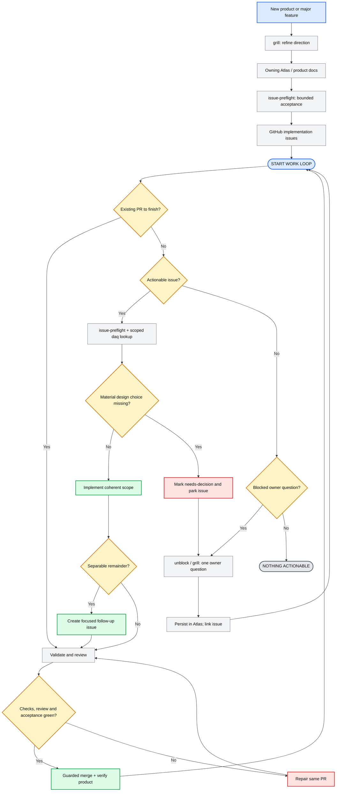

# dotfiles

Personal development-environment and reusable coding preferences.

## What belongs here

This repository stores portable defaults that are useful across projects. Repository-local configuration and pinned conventions remain authoritative when a project needs different behavior.

Keep secrets, credentials, machine-specific paths, and Git identity out of the repository.

## Home-level defaults

- `.gitconfig` — fast-forward-only pulls, pruned fetches, automatic upstream setup, rerere, zdiff3 conflicts, histogram diffs, autostash for explicit rebases, and review-friendly commit/status defaults.
- `.config/git/ignore` — only OS/editor trash. Semantic project ignores such as `.env` remain owned by each repository.
- `.editorconfig` — LF line endings, final newlines, two-space defaults, 100-column guidance, and Rust/Makefile overrides.

On Linux or WSL, preview the home links with:

```sh
node scripts/link-home.mjs --dry-run
```

Apply them with:

```sh
node scripts/link-home.mjs
```

The linker is intentionally non-destructive: it refuses to replace an existing file or unrelated symlink.

## Project coding preferences

- `.oxfmtrc.json` — Oxfmt formatting defaults with deterministic import sorting.
- `.oxlintrc.json` — Oxlint correctness, suspicious-code, performance, TypeScript, control-flow, and import rules.
- `eslint.config.mjs` — dependency-free ESLint flat-config baseline for JavaScript projects that still need ESLint-specific integrations.

Copy or symlink these into a project when appropriate, then keep project-specific additions in that project. Do not make a project depend on this repository at runtime.

## Coding-agent workflow

**Design first for new products and major features:** `grill` → owning Decision Atlas / existing product docs → `issue-preflight` → implementation issues → `work-loop`. Already-specified work, routine bugs and refactors can enter the loop directly. No second scheduler or queue is needed.

Implementation work runs through one global loop over GitHub issues. Design discussions use reusable skills without creating another loop:

- `skills/work-loop` — scan open issues across the repositories, pick an actionable one, work in its repository by that repository's `AGENTS.md`, validate, update GitHub, repeat. Its `workctl.mjs` helper scans the open PR backlog, deterministically reports PR readiness, rejects stacked PR bases, and guards merges. A dependency on another repository becomes an issue there.
- `skills/unblock` — resolve blocking Questions discovered during execution; record owner answers in the Atlas when present, then link and unblock the issue.
- `skills/grill` — refine new product/major-feature direction **before** implementation issues; ask one consequential question at a time, then record concise Decisions/Questions in the owning Atlas when present (otherwise existing docs).
- `skills/issue-preflight` — translate approved direction into bounded, independently verifiable issues; if a major design choice is unresolved, route back to `grill` before implementation.
- `skills/acceptance-contract` — for changes to behavior or architecture, hand off specification-based acceptance tests to an independent agent before implementation, protect behavioral assertions, and fail closed to full test execution when impact mapping is uncertain.

GitHub issues and pull requests are the only **execution state**. Product intent lives in the owning repository's Decision Atlas when present; roadmaps, ADRs and tests provide supporting detail without duplicating decision authority. Repositories keep their own instructions, conventions, tests and architecture; they do not define their own agent loops, claims, queues or status labels.


### Work-loop mental model

The skill file is the operational definition; this diagram is the human-readable control flow. A current issue should produce one coherent PR. If the selected issue contains separable remainder beyond one coherent PR, create focused follow-up issues for that remainder rather than expanding the PR indefinitely. Unrelated findings are not added to the work queue.



To define a new product or major feature, invoke `grill` first (for example, "/grill ARPG combat architecture"). It asks one consequential question at a time, normally 3–5 per session, and persists the answers in the repository-owned Atlas when present. Use scoped `daq` queries to reuse settled decisions; when the tool is unavailable, read the relevant Markdown. Only then use `issue-preflight` to turn that direction into bounded implementation issues. During work, `unblock` is the fallback for genuinely new blocking Questions. Neither skill requires a new global database, label, or queue. The work loop also invokes `acceptance-contract` for behavior and architecture changes. Independent acceptance authorship is a procedural handoff, not something a commit author or code review alone can prove.

Install the skills for Claude Code and Codex by symlinking them:

```bash
mkdir -p ~/.claude/skills ~/.agents/skills ~/.local/share/coding-agent
for s in skills/*/; do
  ln -sfn "$PWD/$s" ~/.claude/skills/"$(basename "$s")"
  ln -sfn "$PWD/$s" ~/.agents/skills/"$(basename "$s")"
done
ln -sfn "$PWD/skills/work-loop/workctl.mjs" ~/.local/share/coding-agent/workctl.mjs
```

Run the linked helper with `node ~/.local/share/coding-agent/workctl.mjs scan` for the global PR backlog or `node ~/.local/share/coding-agent/workctl.mjs pr dotfiles#15` for one PR.
The helper requires Node.js 22.18+ on the 22.x line or Node.js 24.2+ on newer lines for native
ESM entry-point detection (`import.meta.main`). Symlink invocation needs no launcher. Importing
the module keeps the exported helpers available without running the CLI.

## VS Code

- `.vscode/settings.json` — save-time Oxfmt then Oxlint fixes, focused navigation/refactoring aids, explicit Git synchronization behavior, compact editor presentation, and Rust/TOML formatting.
- `.vscode/extensions.json` — Oxc, ESLint, EditorConfig, Rust Analyzer, TOML, WSL, and Dev Container recommendations.

The VS Code files are reusable workspace defaults. User-settings locations differ between Windows-hosted VS Code, WSL, and native Linux, so they are not linked automatically.

## Validation

Run:

```sh
node scripts/check.mjs
```

Configuration validation uses the tools that own the formats: Git validates `.gitconfig`, ESLint loads `eslint.config.mjs`, Oxlint loads `.oxlintrc.json`, and Oxfmt loads `.oxfmtrc.json`. JSON-only VS Code files are parsed directly. The check also runs the work-loop helper tests, including symlink CLI and import regressions, and `git diff --check` over unstaged and staged changes.

`eslint`, `oxlint`, and `oxfmt` must already be on `PATH`. Validation never installs tools or performs hidden network access.

## Convention policy

This repository currently does not pin `coding-agent-conventions`. Agents should use the published machine-readable shared conventions as fallback policy without silently installing or updating them.
