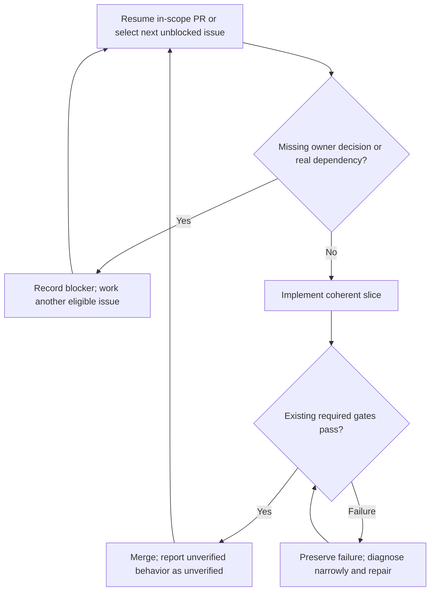

# Steering and development flow

The owning repository's `AGENTS.md`, product Decisions and installed conventions govern behavior. See `skills/*/SKILL.md` for procedures.

## Product decisions

`/steer` handles guided questions and free-form ideas. Record unambiguous owner intent in the owning Atlas or existing product docs. Reconcile only necessary, independently useful issues via `issue-preflight`. Undecided proposals remain Questions; an unmerged authoritative intent PR blocks implementation of its dependent issues.

`/tech-steer` records consequential technical choices. `/unblock` asks only for missing decisions on actual blocked issues. `/work-loop` is a separate implementation task.

## Happy-path work loop

`/work-loop` selects the oldest eligible issue within the owner's scope and implements directly. One active implementation writer per repository. No proactive acceptance agent, tests-first commit, exploratory test suite, browser audit, AI review or post-merge deployment inspection. Existing required gates still apply.

Escalate verification only for a concrete failure, serious security/data-integrity risk, repository-required gate or owner request. `acceptance-contract` supplies independent evidence when requested or needed for a serious defect; it is not a standard preimplementation stage.

Product intent lives in the Atlas; issue/PR/checkout state records work. A merge proves the change landed, not that an untested demo worked. If an actual deployment or user regression is reported, reopen the same issue and repair it. Do not reopen issues solely because optional verification was not performed.
