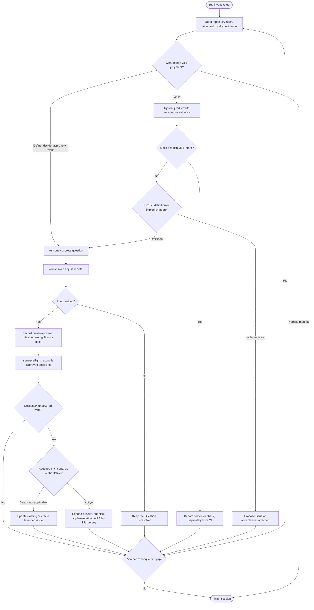
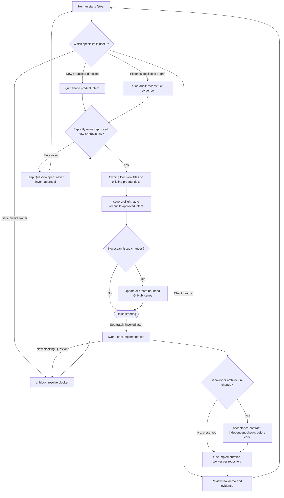
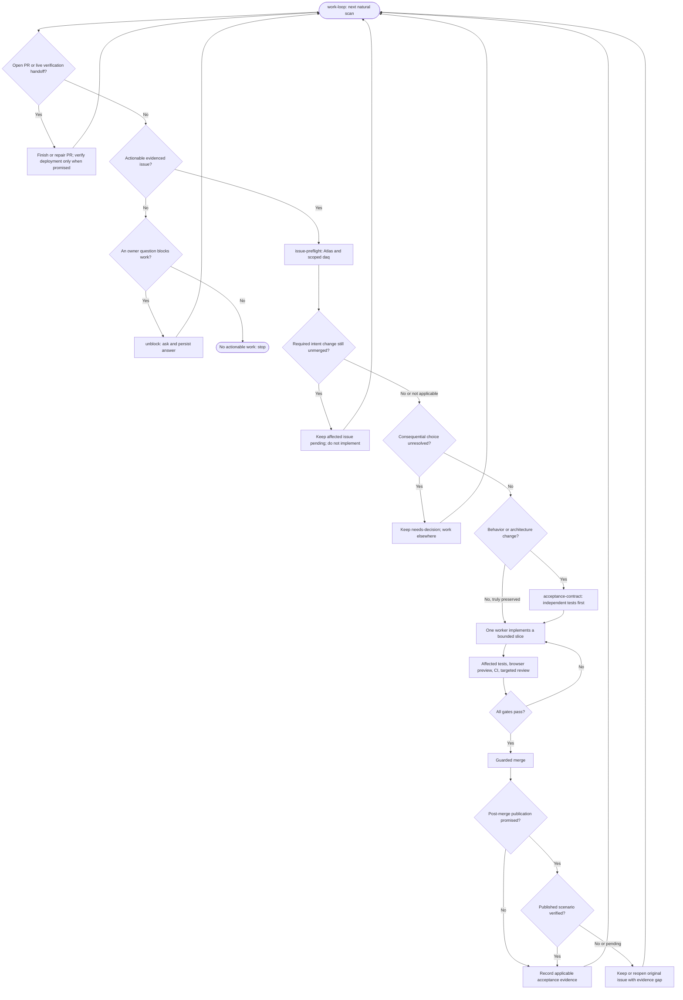
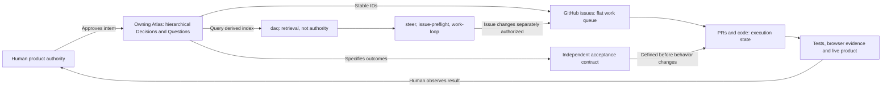

# Human steering and coding loops

These diagrams explain the **human-facing process**, the reusable skills, the implementation
loop, and the sources of authority. They do not introduce a new orchestrator or policy.
The procedures in `skills/*/SKILL.md` and the owning repository's local instructions are
operationally authoritative. For the existing detailed work-loop flowchart, see the
[dotfiles README](../README.md#work-loop-mental-model).

## 1. Your loop — use `/steer`

Start in the repository you want to shape. The agent identifies **one meaningful human
judgment at a time**. It must not treat a green CI check as your product approval.

`Define`, `decide`, `approve`, and `revise` change **intent** when you answer. `Verify`
checks the actual product against that intent. An implementation mismatch proposes a
correction; it does **not** automatically change your Decisions. Recording an approved
answer also authorizes **automatic issue reconciliation**. It does not authorize
implementation, merging or deploying.

## 2. Which skills are used?

`/steer` is a **single human entry point**, not another worker. Specialized skills retain
their original responsibilities; they can still be invoked directly.

`atlas-audit` is investigative; implementation history or an agent proposal is not owner
approval, even when historically evidenced. `unblock` is the fallback for questions discovered while working. New major
features go through `grill` **before** implementation. `issue-preflight` automatically
reconciles approved steering Decisions, but cannot start `work-loop` or make speculative
issues. An issue linked to an unmerged Atlas PR is not yet actionable.

## 3. The agent implementation loop

Once there is approved direction and an authorized actionable issue, implementation is
mechanical wherever possible. Exactly **one active implementation worker per repository**;
independent acceptance authorship happens **before** changing behavior/architecture, not
as a simultaneous competing writer.

`workctl` checks mechanical PR readiness; it cannot approve product intent. Any required owning product-intent change must already be merged before its issue
becomes actionable. Independent
acceptance authorship is required for behavior or architecture changes, not a genuinely
behavior-preserving refactor. Post-merge live verification applies only when the issue
contract promises a published scenario. A merged feature
or green unit suite is not evidence that the published end-to-end scenario works. If the
live check is missing, stale, failing or still publishing, preserve the issue and evidence
for the next natural scan; do not poll or declare success prematurely. If a slice is
oversized, create or reuse focused successors rather than hiding unfinished scope.

## 4. Where knowledge and evidence live

The **Decision Atlas is a hierarchy** for durable owner-controlled intent; its default
semantic leaves are only Decisions and Questions. **GitHub issues form a mostly flat
execution queue** and PRs track implementation. `daq` is a derived way to query Atlas
source, not another database of truth. Existing vision, roadmap and ADR documentation
can add detail without overriding current Decisions. Tests and demos are evidence, not
owner approval. Where no Atlas exists, use the existing authoritative product documents
rather than imposing a competing Atlas.

## What you actually do

Launch `/steer`, answer one concrete product question (or try one real scenario), and
adjust or approve the outcome. The agent records approved intent in a reviewable
repository change and **automatically reconciles only necessary bounded GitHub issues**.
Issues referencing unmerged product-intent PRs remain non-actionable until that source merges.
A separately invoked `/work-loop` then handles implementation, technical verification,
review, guarded merge and published-scenario checks. If the visible result is wrong, return to `/steer` to
distinguish changed intent from defective implementation.
