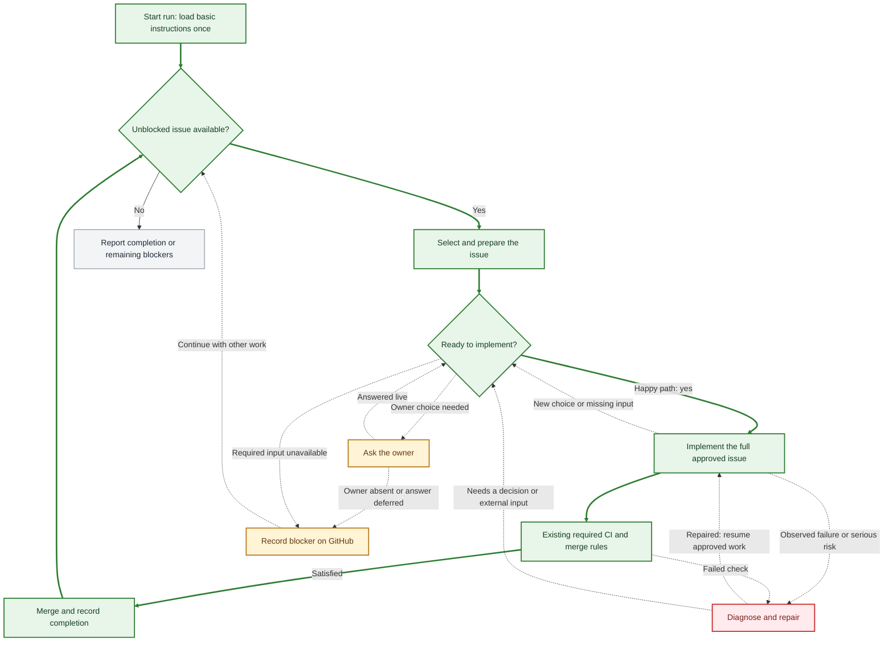
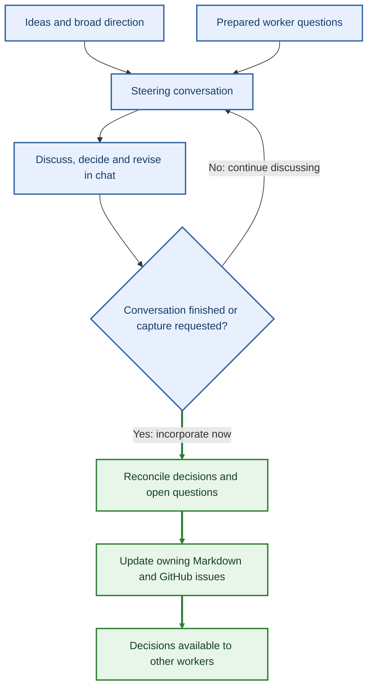

# Steering and development flow

Approved workflow, 2026-10-17. [Work-loop instructions](../skills/work-loop/SKILL.md) · [Owner questions and incorporation](owner-questions.md).

**Legend:** thick green arrows mark the happy path; dashed arrows mark exceptions. Blue is conversation, amber is a decision/input blocker, and red is failure investigation.

## Work loop

Resume existing in-scope work before selecting another issue. Prepare with the same implementing worker; obtain ordinary prerequisites and ask only the remaining owner choices. Load the basic instruction baseline once per run.

- **Owner choice:** reuse settled preferences; ask about remaining user-facing behavior/scope even when reversible. `ask:live` asks now; `ask:github` (default) records unanswered questions and continues elsewhere.
- **Missing input or oversized work:** obtain available inputs first. Propose a usable split with the remaining obligations; obtain owner approval before smaller delivery unless already approved.
- **Failure:** investigate observed failures, concrete serious risks or explicitly required/requested checks. Keep repairs narrow and preserve required gates.
- **Completion:** record what landed and what remains unverified. Optional acceptance agents, extra tests, browser/deployment checks and AI reviews are absent from the normal path.

## Steering and incorporation

Broad ideas and prepared issue questions use the same conversation. An explicit live answer may guide the current authorized worker immediately. Recording waits for the owner's end signal; other workers learn decisions through incorporation.

“Capture and incorporate now” completes reconciliation in the same session: apply corrections, update owning records and necessary issues, then report the result. No per-answer GitHub writes, extra confirmation or computer handoff. If a write fails, report the saved and unsaved portions for retry.

Only owner-approved generalizations become shared conventions. Atlas Decisions mean approved intent, Questions mean uncertainty, and `[x]` means built.
